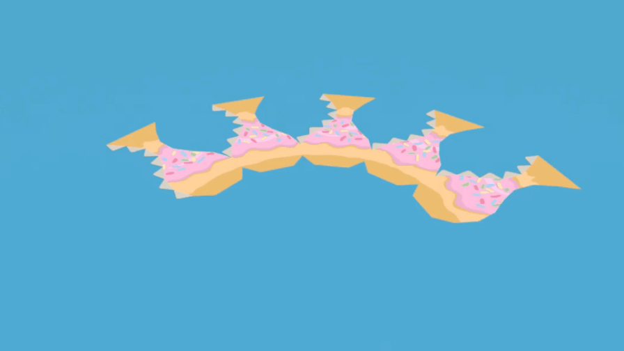
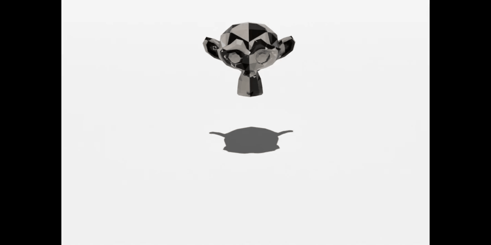

# Papercraft Pro

**Unfold Blender models into printable papercraft: glue tabs, live page
layout, cutter-ready SVGs and an animated fold rig.**


A Blender extension (4.2+) that unfolds a mesh into papercraft pieces with
glue tabs, lays them out live on standard pages beside the model, exports
print- and cut-ready SVG pages (including Cricut cut/score files), and
builds a hinge rig that animates the sheet folding up into the model.


## Features

* **One-click unfold** with automatic cut placement: fewest pieces, seams
  tucked into valley creases, no overlapping pieces.
* **Edit Cuts**: hover and click edges on the model *or* the paper to cut and
  join, Pepakura style. Click tabs to swap sides; Shift+click for outside tabs.
* **Cut rules**: seams, material boundaries, painted colour regions, sharp edges.
* **Live layout** on A4, Letter and other page sizes, updating as you edit.
* **Prints what you see**: Cycles bakes any material (image textures, Paint
  System layers, procedurals, vertex colour) onto the pages, with bleed.
* **Cutting machines**: export cut lines, crease lines, or both, for Cricut
  and similar.
* **Fold animation**: a hinge rig folds the printed sheet up and assembles it
  onto the model, ready to keyframe.



*Specifying cuts and tab direction yields much cleaner part layouts as above, than the automatic unwrap especially on complex models as below.*



## Install

1. Download the latest `papercraft_pro-x.y.z.zip` from
   [Releases](../../releases), or build it with `scripts/build.sh`.
2. In Blender: **Edit → Preferences → Get Extensions → ⌄ → Install from Disk**.
3. Or just drag and drop the zip into Blender.
4. Open the sidebar (**N**) in the 3D view and pick the **Papercraft** tab.

## Use

Everything is per model: select a mesh and the **Papercraft** tab shows
*its* settings, layout and rig. Unfold as many models in one scene as you
like; selecting a layout or rig jumps to its model.

1. Select the model and press **Unfold**. Its pages appear beside it; move
   the layout object anywhere (it stays put; **Reset Layout Position**
   brings it back).
2. **Show Layout** looks straight down on the pages and switches that view
   to Material Preview (Solid mode can't show textures, so pieces would look
   like blank grey shapes). Split the viewport
   (View → Area → Vertical Split) to see model and layout side by side.
3. Turn on **Live Layout** and mark seams in Edit Mode (**Cut Here / Join**)
   to control where the model is cut; the pages update as you work.
4. **Edit Cuts** (Pepakura style): hover an edge on the model *or* the
   paper layout and it lights up in both places; click to cut a fold or join
   a cut. Click a tab to move it to the other side of its seam;
   **Shift+click** a tab to glue it on the *outside*: an outside tab is
   printed with the art of the face it covers (in every print mode, the
   layout preview and the fold rig) and carries no glue number. Works across
   split viewports. Finish with Right-click, Esc or the **Done Editing**
   button; clicks on the sidebar and other editors work normally meanwhile.
   Going into Edit Mode or hitting an error also ends the tool cleanly.
5. **Fold Animation → Build Fold Rig**: a copy of the sheet appears in front
   of the layout, printed side down like paper on a table. **Fold** folds the
   pieces up off the table, each resting on its root piece; **Assemble**
   slides them onto the model. **Keyframe Fold Animation** animates both.
   Tick **One at a Time** to fold hinge by hinge from the extremities
   inwards (glue tabs first, then the tips, the root piece last); **Overlap**
   sets how much each fold overlaps the next (0 = strictly one after
   another, 1 = all together). **Paper Thickness** (mm) gives the sheet real
   thickness for renders: glue tabs end up one thickness behind the wall
   they glue to (outside tabs in front) instead of z-fighting and showing
   through it. Modifiers you add to the folding mesh survive Rebuild Rig. If you change cuts or tabs later
   the panel shows *Rig is out of date*; **Rebuild Rig** keeps your
   keyframes (Edit Cuts rebuilds it for you when you finish). The bin icon
   removes the rig; **Remove Papercraft** (bin by the model name) removes
   everything generated for that model.
   Paper thickness (Fold Animation): gives the folding sheet real thickness for renders. Glue tabs sit one paper thickness behind the wall they glue to (outside tabs in front), 
   so they no longer show through the walls in renders. Modifiers you add to the folding mesh are kept when you rebuild the rig.
6. **Export PDF** writes every page into one PDF at true size (vector
   lines, real text numbers, art at full resolution with its bleed): the
   most reliable way into Photoshop, Krita or a print shop, and it opens at
   whatever resolution you need for PNGs. **Export SVG Pages** writes one SVG per page. **Content** chooses what
   goes in: *Print* (art, tabs, lines, numbers); *Art + Cut Lines* (art on
   the pieces and carried onto the tabs, with only the cut outlines drawn:
   no fold lines over the art; saved with an `_art` suffix); or, for a cutting machine,
   *Cut Lines Only*, *Crease Lines Only* or *Cut + Crease*: plain solid
   strokes with no art or text, saved with a `_cut`, `_crease` or `_lines`
   suffix so you can export both. For a Cricut, turn off **Dashed Folds**
   (it scores each dash separately), upload the cut and crease files, set
   the crease file to *Score* and attach them. In *Cut + Crease* the creases
   are red so they import as their own layer.

### Cut along

* **Seams**: Blender seams (Edit Mode: *Cut Here / Join*, or Edit Cuts).
* **Material Boundaries**: each material becomes its own piece.
* **Colour Boundaries**: paint regions in Vertex Paint mode (or any colour
  attribute) and every colour change becomes a cut.
* **Sharp Edges**: edges marked Sharp.

A *Join* made with Edit Cuts overrides a material/colour/sharp cut.

### Printing

* **Print: Baked Material** (default): Cycles bakes what the material shows
  onto each page, so anything prints: image textures on any UV map, layered
  paint setups such as the very excellent [Paint System](https://extensions.blender.org/add-ons/paint-system/) add-on (its `PS_UVMap` and grouped
  layers), procedurals and vertex colours. *Auto* (default) bakes the base
  colour and falls back to *Emission* for materials that colour through an
  emission path (Paint System materials often do), or pick *Base Colour*,
  *Emission* or *Full Render* yourself (scene lighting, matte: faces turned
  away from your lights print darker); *Bake DPI* defaults to 300. Baking
  runs on temporary copies of your materials, so they are never changed, and
  hides the model itself while baking so it can't shadow its own copy.
  Each bake also bakes a small known grey alongside and reads it back, so
  colours come out true whichever way your Blender build stores the result.
  It also checks that Cycles decodes sRGB image textures: some Blender
  builds skip that (Cycles renders look paler than the viewport), and the
  add-on then decodes your paint itself for the bake, so prints match what
  you painted.
* **Image Textures**: fast; prints the image feeding Base Color (found
  inside node groups too) through the UV map that image uses.
* **Flat Colours** / **Lines Only** for quick tests and cutting machines.
* **Texture on Tabs** (Baked, Image Textures or Flat Colours) carries each
  face's art on across its tabs, so tiny gaps at glued seams don't show tab
  colour. **Grey Tabs** off leaves plain tabs paper white.
* **Bleed**: colour runs a little past each edge (tabs included) so
  imperfect cuts don't show white. Baked pages are trimmed to the pieces
  plus bleed in the image itself, so every program shows the same edge.
* **Numbers**: *On Faces* (inside both glued edges), *Tabs & Scrap* (on
  the tab, and on the scrap just outside the other edge, so nothing prints
  on the art), or *Off*.
* **Lines**: *Custom Colour* (default: black at 10% opacity, 0.25 mm; one
  colour and opacity for every line, e.g. white at 40% over dark art),
  *Default* (black cut, red mountain, blue valley), or *No Lines* (hidden layers,
  still there for a cutting machine). *Line Width* and *Hide Folds Under N°*
  fine-tune it.
* Art + Cut Lines export: art on the pieces and carried onto the tabs, with only the cut outlines drawn and no fold lines over the art. Saved with an _art suffix.
  Texture on Tabs now works with Image Textures and Flat Colours, not just Baked.
  Grey Tabs option: turn it off to leave plain tabs paper white.
  True bake colours: each bake checks itself against a known grey, fixing washed-out prints on some Blender builds.
  Fold rig starts printed side down: pieces fold up off the table like real paper, with no flip.
  One at a Time fold: hinges fold in turn from the extremities inwards (glue tabs, then tips, root last), with an Overlap control.

The layout and folding meshes carry copies of all the model's UV maps and
colour layers, so the model's materials preview correctly on the pages.

### Scale options

* **Fit to Pages**: largest model that fits on N pages.
* **Model Size**: largest dimension in millimetres.
* **Fixed Ratio**: millimetres of paper per Blender unit.

### Materials

The **Material** panel sets what you're building in. The model is the
printed outside surface; the board's thickness sits behind it.

* **Cardstock** (0.3 mm): creased folds, glue tabs, exactly as before.
* **Cardboard** (greyboard, 1.5 mm): creased folds bend round a
  **Fold Radius**, which takes up length, so each piece is shortened at
  every fold to suit (0.64 mm per 90 degree fold at 1.5 mm).
* **Corrugated 3 / 5 / 10 mm**: **V-Groove** folds. The printed liner folds
  sharp on the line and a V is carved out of the back (10 mm wide for a 90
  degree fold in 5 mm board). Seams are **Mitre** joins: no tabs, and at
  outside corners the back is bevelled away (5 mm for a 90 degree corner in
  5 mm board) so the boards meet flush. Inside corners need no carving.
  Inward (valley) folds can't be grooved in thick board, so **Cut Valley
  Folds** cuts them; Edit Cuts joins still win, and the panel says how many
  inward folds are left.

Every setting can be adjusted after picking a material. Export **Back
Marks** for the back of the board: the outline, V-grooves (with the fold
line dashed) and mitre lines, mirrored so they line up when printed on
the reverse of the sheet or traced.

## How it works

* **Cut For** (Pieces & Tabs): *Auto* (default) unfolds twice, folding
  the longest edges first (*Fewest Pieces*) and the flattest first (*Seams
  on Creases*), and keeps the better result: fewest pieces, while avoiding
  comb-shaped pieces whose seams sit tight together (fiddly to cut and
  assemble). The panel shows which it chose; live edits reuse that choice.
* Faces are joined greedily in that order; a join is refused if pieces would
  overlap, and that edge becomes a cut. Faces left stranded in tiny pieces
  (3 faces or fewer) get their edges tried first in up to five extra passes,
  keeping the result with the fewest pieces.
* **Prefer Valley Cuts** (default 0.5) nudges cuts onto inward (valley)
  edges, where seams hide in the creases; it settles close calls rather
  than forcing every valley open.
* Faces bent out of plane are split into triangles (paper cannot bend).
* Each piece keeps a hinge tree (parent face, hinge edge, fold angle). The
  rig turns each hinge into a bone whose Y axis lies on the fold, driven by a
  simple driver expression (no Python auto-run needed).
* Tabs along a seam (a run of cut edges between the same two pieces) all go
  on the same side, so a seam is glued in one direction; a tab only
  switches side where that side has no room.
* Every tab is trimmed to the shape of the face it glues onto, so it never
  sticks out past that face, and folds the same way that face does
  (mountain or valley). Tab sides lean to fit the free space at each
  corner and tabs shorten rather than run into neighbouring pieces.

## Development

The geometry core (`papercraft_pro/core`) is pure Python and runs
outside Blender:

```bash
python tests/test_core.py          # unfold, refold and layout checks
python tests/test_blender.py       # end-to-end, needs `pip install bpy`
python tests/test_v02.py           # textures, line styles, cut rules, editor
python tests/test_v03.py           # several models, rig rebuilds, baking
python tests/test_v04.py           # cutting order, tab rules
python tests/test_v05.py           # outside tabs, tab fold direction
python tests/test_v06.py           # cutter exports, clean Full Render bakes
python tests/test_v07.py           # Edit Cuts always exits cleanly
python tests/test_v08.py           # art + cut export, colour check, fold order
python tests/test_v09.py           # paper thickness, tabs clear their walls
python tests/test_v10.py           # PDF export, trimmed baked pages
python tests/test_v11.py           # pale-texture check and fix
python tests/test_v12.py           # thick materials: grooves, mitres, creases
```


* Drag pieces around the page
* Pop-up mechanism design add-on built on the same hinge rig
* Joining parts of separate models with a bridge mode
* Improving animation options

## Roadmap

* **Mitre folds** for thick board: inward (valley) folds that keep the
  pieces joined. A mitred V is carved from the printed side and the pieces
  are spaced apart by the groove width so the faces close up exactly when
  folded. Where several inward folds meet at a corner and can't lie flat,
  that fold is cut instead and the panel says so.
* **Large sheets**: A2, A1 and A0 page sizes and common cardboard sheet
  sizes for board builds, plus saving your own Custom sizes as named
  presets that are kept between files.
* **Editable sizes in the main panel**: type the model size (or the
  page size) straight into the summary, which is read-only today, instead
  of switching Scale mode first. The layout updates to match.
* Drag pieces around the page.

## Licence
Made by [Kim Lang](https://kim-lang.com/) [@Liatach](https://github.com/Liatach) with LLM assistance 2026
GPL-3.0-or-later, see [LICENSE](LICENSE). 
Blender is a trademark of the Blender Foundation; this add-on is not affiliated with or endorsed by it.
